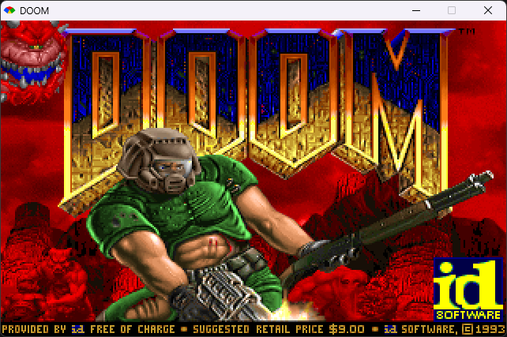

# ruby_doom



**Video:** [DOOM running in Ruby](https://youtu.be/h8wSVxCc_9g)

**Repository:** [github.com/vagucs/rudy_doom](https://github.com/vagucs/rudy_doom)

DOOM generic ported from **[python_doom](https://github.com/vagucs/python_doom)** to **Ruby 3.4 + SDL2**.

By **Wagner Nunes da Silva**

- vagucs@bol.com.br
- vagucs@vagucs.com.br
- vagucs@gmail.com
- [www.vagucs.com.br](https://www.vagucs.com.br)
- [LinkedIn](https://www.linkedin.com/in/wagner-nunes-da-silva-b0a15360)

Versão em português: [README.pt.md](README.pt.md)

---

## What this project is

`python_doom` is a condensed, playable DOOM engine in Python. This directory starts the **same study piece**, in Ruby:

- Window and keys: **SDL2**, reached through the `ffi` gem. The engine does not live in that bridge
- Framebuffer: 320×200, stretched in a 640×400 window
- 16.16 fixed-point: `lib/doom/compat.rb`, the same math as `doom/compat.py`. A Ruby integer grows on its own, and `>>` fills with the sign
- IWAD: `lib/doom/wad.rb`

You need a legal IWAD (shareware `doom1.wad` or commercial `doom.wad` / `doom2.wad`). This repository does not ship commercial WAD data.

---

## Educational purpose

The Python port already dropped the preprocessor and Harbour's 1-based arrays. The Ruby port asks what changes when the integer grows on its own and `>>` fills with the sign, with no C file.

- **Python, then Ruby.** Open `python_doom/doom/` next to `ruby_doom/lib/doom/`.
- **Wrap, written down.** `as_i32` brings a 16.16 product back to 32 bits.
- **Where Ruby is enough.** The WAD directory, the patch, and the loop stay in Ruby. SDL2 is the window.

---

## From Python to Ruby

| Python (`python_doom`) | Ruby (`ruby_doom`) |
| --- | --- |
| `thing.x` | `thing.x` |
| `None` | `nil` |
| `items[0]` | `items[0]` |
| class | `class` |
| unbounded `int` | unbounded `Integer`; `as_i32` cuts it to 32 bits |
| `//` | `/` on integers, which also floors |
| framebuffer `bytearray` | a binary string |
| pygame | SDL2 through `ffi` |

---

## Technology

| Layer | This port | Python (`python_doom`) |
| --- | --- | --- |
| Language | Ruby 3.4, `C:\Ruby34-x64\bin\ruby.exe` | Python 3.10+ |
| Window | SDL2, `ffi` gem | pygame 2.x |
| 16.16 fixed-point | `lib/doom/compat.rb` | `doom/compat.py` |
| IWAD | `lib/doom/wad.rb` | `doom/wad.py` |

---

## How to run

From this directory, on Windows:

```
run.bat
run.bat -fps
run.bat -iwad ..\DOOM1.WAD
```

`-iwad` chooses the file. A bare path ending in `.wad` also works. `-warp` skips the title and opens the map. `-fps` draws the frames per second in the upper right. F11 toggles that counter. The search starts at `DOOMWADDIR` or `DOOMWADPATH`, then this folder and the folders above it. `lib/SDL2.dll` is the 64-bit library the `ffi` gem loads.

Measured on this machine, the same scene runs at **40 FPS** with YJIT and **17 FPS** without it. `run.bat` starts Ruby with `--yjit`.

---

## Keys

| Key | Action |
| --- | --- |
| **Enter** | Confirm the menu item. On the title, enter the map |
| **Left / right arrow** | Turn |
| **Up / down arrow** | Walk. Shift runs |
| **Space** or **E** | Open the door ahead or use a switch |
| **Ctrl** | Fire the gun in hand |
| **1** to **7** | Change weapon |
| **Tab** | Open and close the automap |
| **- / +** | View size inside the window |
| **F11** | Turn the frame counter on and off |
| **Esc** | Opens the menu |
| **Alt+Enter** | Full screen |
| **Alt** | Strafe |
| **, / .** | Sidestep |
| **Mouse** | Turn and look. Button fires |
| **Pause** | Pause |
| Close the window | Quit |

---

## Lineage

1. **[python_doom](https://github.com/vagucs/python_doom)** — Python + pygame
2. **[rudy_doom](https://github.com/vagucs/rudy_doom)** — Ruby 3.4 + SDL2 (this tree)

---

## Donate

### GitHub Sponsors

[github.com/sponsors/vagucs](https://github.com/sponsors/vagucs)

### Ethereum

`0x1b64038A2b1DB73ABd0068d8B9B0d1dC5a90C5F1`


### PIX

Key: `vagucs@bol.com.br`


